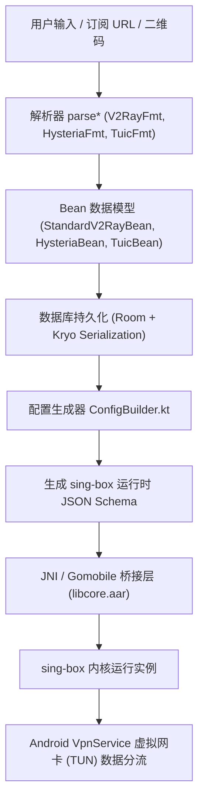

# NekoBoxForAndroid 业务与协议处理逻辑链条

## 1. 核心业务数据流 (Mermaid DAG)

## 2. 协议转换与参数防呆矩阵

| 协议 | 关键参数 | 格式解析别名支持 | 目标 sing-box 字段 | 异常防呆处理 |
| :--- | :--- | :--- | :--- | :--- |
| **Hysteria 2** | 端口跳跃 (`server_ports`) | `mport`, `ports` | `server_ports: []` / `server_port: int` | 过滤空串，单端口转 int，混合范围支持 `start:end` |
| **Hysteria 2** | 混淆认证 (`obfs`) | `obfs-password`, `obfs_password`, `obfs` | `obfs.type = "salamander"` | 密码为空时不生成 obfs 块 |
| **VLESS Reality** | 爬虫引导路径 (`spider_x`) | `spx`, `spider_x` | `tls.reality.spider_x` | 缺省为空，自动注入 chrome uTLS 指纹 |
| **TUIC v5** | 拥塞控制 (`congestion_control`)| `congestion_controller`, `cc` | `congestion_control` | 默认为 bbr |
| **Android 15**| 前台服务 (`ForegroundService`) | `specialUse`, `systemExempted` | `AndroidManifest.xml` | 声明 `PROPERTY_SPECIAL_USE_FGS_SUBTYPE` 防系统杀后台 |
